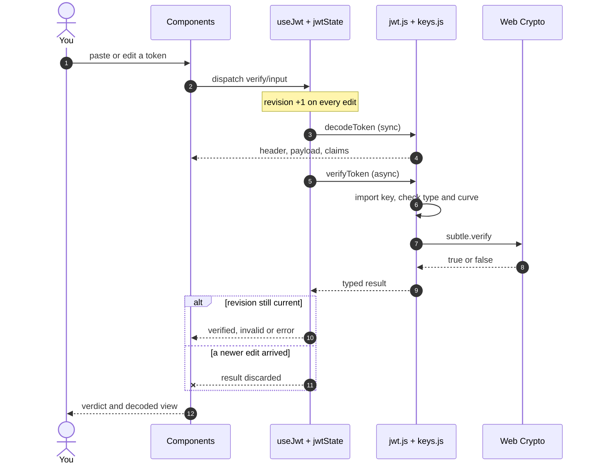

<p align="center">
  
</p>

<p align="center">
  <a href="https://jwt-playground-beta.vercel.app"><b>Open the playground</b></a> ·
  <a href="#architecture">Architecture</a> ·
  <a href="#algorithms-and-keys">Algorithms</a> ·
  <a href="#security-model">Security model</a>
</p>

<p align="center">
  
  
  
  
</p>

# JWT Playground

Decode, verify and sign JSON Web Tokens in the browser. Nothing is sent to a server: the production build's
Content-Security-Policy denies all network connections, and nothing is written to storage.

| | |
| --- | --- |
| **Decode** | Header, payload and registered claims, with the token's three parts colour-coded. |
| **Verify** | Check a signature against a secret or public key. The token is never rewritten. |
| **Sign** | Build a new token from editable JSON and a key. Output is labelled as newly generated. |
| **Copy** | One click copies the token, any single segment, a claim, or a key. |

## Quick start

```
npm install
npm start      # dev server (Vite)
npm test       # unit, interoperability and UI tests
npm run build  # production build in build/
```

Needs Node 22. Cryptography is Web Crypto only, so it runs in a secure context (HTTPS or localhost).

## Architecture

<p align="center">
  
</p>

Data moves one way down and one way back. Components never touch crypto; the logic layer never touches React.
The only network use is the page load itself.

### What happens when you edit a token



A late async result can never overwrite newer input: each draft carries a revision, the effect discards results
from older revisions, and the reducer rejects stale ones a second time.

## Two modes

- **Verify** decodes the token you paste (read-only) and checks its signature against the key you supply.
  Changing the key or its format only re-checks that exact token; it never signs, rewrites or normalises it.
  Surrounding whitespace is ignored for checking and disclosed; your input is left as typed.
- **Sign** builds a new token from an editable header and payload and a signing key. Any change re-signs.
  The output is labelled as newly generated, never as verified.

Each mode keeps its own draft. "Signature verified" means only that the signature matches the key. It does not
validate issuer, audience, authorization or time claims; time flags (expired, not yet valid) use the device clock
and are shown separately.

## Algorithms and keys

| Family | Algorithms | Key to verify | Key to sign |
| --- | --- | --- | --- |
| HMAC | HS256, HS384, HS512 | secret | same secret |
| RSA | RS256, RS384, RS512 | public key | private key |
| RSA-PSS | PS256, PS384, PS512 | public key | private key |
| ECDSA | ES256 (P-256), ES384 (P-384), ES512 (P-521) | public key | private key |
| EdDSA | EdDSA (Ed25519 only) | public key | private key |

- **HMAC secrets** are UTF-8 text or Base64URL bytes (binary secrets work).
- **PEM keys** are unencrypted. Public keys: `BEGIN PUBLIC KEY` (SPKI) or `BEGIN RSA PUBLIC KEY` (PKCS#1). Private
  keys: `BEGIN PRIVATE KEY` (PKCS#8), `BEGIN RSA PRIVATE KEY` (PKCS#1) or `BEGIN EC PRIVATE KEY` (SEC1). PKCS#1 and
  SEC1 keys are re-wrapped into PKCS#8 or SPKI before import (`src/der.js`); this changes the encoding, not the key.
  Encrypted keys, certificates and PEM headers are refused with a conversion hint.
- **Checks:** RSA keys must be 2048 bits or more. The key's type and curve must match the token's algorithm, and a
  public key is never accepted for signing or a private key for verifying.
- **RSA-PSS** uses a salt as long as the digest, as JWA requires. **EdDSA** needs a browser with Ed25519 in Web
  Crypto (current Chrome, Edge, Firefox and Safari); otherwise the key panel says so. Ed448 is not supported.
- `none` and every algorithm outside the table are reported as unsupported, never verified. Tokens with `crit`
  extensions or `b64: false` are refused. There is no key lookup, JWKS fetch or `kid` handling.

## Security model

| Guarantee | How it is enforced |
| --- | --- |
| No network requests | `connect-src 'none'` in the CSP, sent as a header (`vercel.json`) and as a `<meta>` tag; `security.test.js` keeps them in sync. |
| No third-party code or fonts | `script-src 'self'`, `font-src 'self'`; fonts ship in the bundle. |
| Nothing persisted | The app never writes to storage. Closing the tab clears everything. |
| No hand-rolled crypto | Every signature goes through `crypto.subtle`; `src/der.js` only re-wraps key encodings. |
| Keys never cross types | HMAC reads only the secret, RSA/ECDSA read only the PEM, so a public key can never become an HMAC secret. |

## Layout

- `src/jwt.js`: pure logic with typed results (`decodeToken`, `verifyToken`, `signToken`, `describeClaims`).
- `src/keys.js`: algorithm registry, secret bytes and PEM import. HMAC reads only the secret and RSA/ECDSA read only
  the PEM, so a public key can never be reused as an HMAC secret.
- `src/base64url.js`, `src/der.js`, `src/jwtErrors.js`: encoding, key re-wrapping and the error-code contract.
- `src/jwtState.js`, `src/useJwt.js`: two drafts with per-draft revisions bumped on every edit, so a late async
  result can never overwrite newer input.
- `src/status.js`: result objects to user-facing words. `src/App.jsx` and friends: plain components.
- `src/styles.css` (tokens and layout), `src/interactions.css` (selection, copy controls, motion) and
  `src/motion.js` (scroll reveals, off under `prefers-reduced-motion`). No UI library, no crypto dependency.

## More

- [Product requirements](docs/jwt-playground-functionality-prd.md) and
  [technical requirements](docs/jwt-playground-functionality-trd.md).
- The diagrams in `docs/` are hand-written SVG, so they stay sharp at any size and carry the site's palette.

